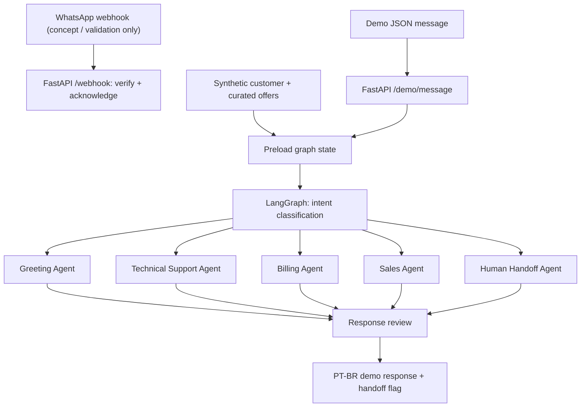

<div align="center">

# Agentic AI Telecom Customer Support

### A context-aware, multi-agent customer service concept for Brazilian telecoms

**Python · LangGraph · FastAPI · PostgreSQL · WhatsApp Webhook Design**

**Portfolio Prototype** | **Portuguese (PT-BR)** | **Human Handoff**

</div>

---

## The Problem

Living in Brazil and using local telecom services gave me a first-hand view of a common customer experience: frequent calls, language friction, repeated explanations, and support conversations that do not always reach the right team quickly. Customers need a simpler way to ask about slow internet, bills, plans, and promotions—without navigating a rigid menu every time.

**The design challenge:** How can one assistant understand the customer's request, use relevant context, and direct the conversation to a specialized support flow while keeping a human operator available?

## The Idea

I designed an **agentic customer-support architecture**, inspired by common use cases in the Brazilian telecom sector, including Claro and Vivo. A customer-facing WhatsApp experience is the intended future channel; this repository implements a **local demonstration API**, not a live WhatsApp integration.

The concept includes five specialist routes:

- **Greeting:** start a natural conversation in Brazilian Portuguese.
- **Technical support:** handle internet speed, Wi-Fi, and signal questions.
- **Billing:** display an explicitly fictional invoice preview, subject to demo verification.
- **Sales:** suggest a fictional plan or promotion using preloaded preferences and offers.
- **Human handoff:** escalate unrecognized or sensitive requests rather than inventing answers.

The focus is **understandable orchestration, explicit state, and clear system boundaries**, not infrastructure complexity.

## High-Level Design (HLD)



**[View the architecture diagram](architecture.png)** · **[Edit HLD in diagrams.net](architecture.drawio)**

> **Important design decision:** LangGraph does not query the database. An API-boundary helper randomly selects one **fictional customer** and loads a limited offer catalog *before* the graph starts. A production integration would use authenticated identity resolution instead of random selection.

## Technology Stack

| Component | Technology | What it demonstrates |
|---|---|---|
| Agent orchestration | **LangGraph** | Typed state, an Annotated list reducer, conditional edges, specialist nodes, compile/invoke |
| API | **FastAPI + Pydantic** | Validated request and response models, independent demo endpoint |
| Messaging boundary | **Webhook design** | Meta verification challenge and HMAC-SHA256 signature validation; inbound messages are only acknowledged |
| Relational data design | **PostgreSQL** | DDL for customers, authorized contacts, interactions, and offers |
| Personalization | **Curated offer context** | A small preloaded product catalog (CAG-inspired), without repeated lookups inside agents |
| Conversation context | **Synthetic memory summaries** | Previously-known context included in the agent state; no embedding or persistence |
| Language | **PT-BR** | Customer-facing Portuguese response examples |

## LangGraph Workflow: Real Graph API

The orchestration is implemented in **[`langgraph_agent.py`](langgraph_agent.py)**, not as a pseudo-code illustration. It uses:

- `StateGraph(AgentState)` for a single typed shared state.
- `add_node()` for intent classification, five specialist handlers, and final response review.
- `add_conditional_edges()` to select exactly one specialist at runtime.
- `START` and `END` to explicitly define graph entry and termination.
- `Annotated[list[str], operator.add]` to accumulate a reproducible node execution trace.
- `compile()` and `AGENT_GRAPH.invoke()` for graph construction and invocation.

```python
builder = StateGraph(AgentState)
builder.add_node("classify", classify)
# ... five specialist nodes and a final review node are registered ...
builder.add_edge(START, "classify")
builder.add_conditional_edges("classify", route, {"greeting": "greeting", "technical": "technical", "billing": "billing", "sales": "sales", "human": "human"})
builder.add_edge("review", END)
AGENT_GRAPH = builder.compile()
```

The complete implementation lives in the Python file. In this small educational prototype, each specialist is a LangGraph node with deterministic behavior; an actual LLM, vector memory, and production integrations are deliberately out of scope.

## Message Flow

1. **Receive** a sample message through `POST /demo/message`.
2. **Select** a random synthetic customer and inject a bounded set of mock offers into state.
3. **Classify** intent using a **deterministic keyword router** that stands in for a future LLM classifier.
4. **Route** the message to the corresponding specialized LangGraph node.
5. **Review** the response and return a Portuguese answer, intent, handoff flag, and a graph-node trace.

This distinction matters: **the current agents are rule-based and template-driven**. The repository does not make an OpenAI call or claim a fully autonomous LLM agent.

### Example

**Customer:** `Minha internet está lenta.`

**Illustrative route:** `technical` → clarify whether Wi-Fi or all devices are affected → return a troubleshooting prompt in PT-BR, using the customer's synthetic context summary.

Other demonstration paths include invoice previews, sales offers matched to mock interests, and human escalation. Campaign previews are suppressed for profiles without marketing consent.

## Repository Structure

```text
.
├── README.md
├── architecture.drawio    # Editable HLD
├── architecture.png       # HLD preview
├── architecture.svg       # Vector HLD preview
├── langgraph_agent.py     # Real StateGraph: nodes, edges, reducer, compile
├── main.py                # FastAPI demo API + webhook verification
├── postgres.py            # PostgreSQL DDL + synthetic profiles/offers
├── requirements.txt       # Runtime dependencies
├── requirements-dev.txt   # Optional pytest dependency
├── tests/                 # LangGraph behavior checks
└── .gitignore
```

## Optional Local Exploration

```bash
python -m venv .venv
# Windows: .venv\Scripts\activate
# macOS / Linux: source .venv/bin/activate
pip install -r requirements.txt
uvicorn main:app --reload
```

Send a fictional customer message:

```bash
curl -X POST http://127.0.0.1:8000/demo/message \
  -H "Content-Type: application/json" \
  -d '{"message":"Minha internet está lenta"}'
```

Preview an offer (no outbound message is sent):

```bash
curl -X POST http://127.0.0.1:8000/demo/message \
  -H "Content-Type: application/json" \
  -d '{"message":"oferta","mode":"campaign_preview"}'
```

The selected fictional profile may differ on every demo request. These commands explain how the code is intended to run; they are **not a claim of live deployment or integration testing**.

### Optional Unit Tests

```bash
pip install -r requirements-dev.txt
pytest -q
```

These tests verify routing, node execution traces, invoice authorization gates, marketing opt-out handling, and the no-DB-access boundary. The test cases are provided for review; no CI or deployment is claimed.

## Safety and Privacy Boundaries

- **No real accounts:** names, numbers, prices, and invoices are mock fixtures, not customer records or current operator offers.
- **No sender-to-account trust:** the WhatsApp webhook does not pick a random account or expose billing data.
- **Demo-only billing authorization:** production access would require verified identity and explicit authorization.
- **Consent-aware previews:** unsolicited promotional sending is not implemented.
- **Human escalation:** unrecognized requests are marked for handoff, but no real ticket is created.
- **LGPD-oriented future design:** a real system would require a lawful basis, minimization, retention controls, access auditing, and deletion procedures.

## Prototype Scope and Roadmap

**Included in this repository:** a compiled LangGraph StateGraph implementation, five conditional support paths, synthetic data, a PostgreSQL schema contract, a FastAPI demo route, webhook validation scaffolding, and an editable HLD.

**Not included:** a live PostgreSQL connection, vector storage, embeddings, actual LLM calls, long-term persisted memory, outbound WhatsApp messaging, voice-call answering, real telecom APIs, CRM tickets, production deployment, or compliance certification. The cached catalog is **CAG-inspired context reuse**, not an implemented or measured LLM prompt cache.

A realistic next iteration would add authenticated customer mapping, the official WhatsApp Business Platform, persistent conversation state, structured LLM classification, operator queueing, automated tests and observability.

---

**Disclaimer:** This is an independent educational and portfolio project. It is **not affiliated with, endorsed by, or connected to Claro, Vivo, Meta, or any Brazilian telecom provider**. All customer data and offer examples are fictional.
